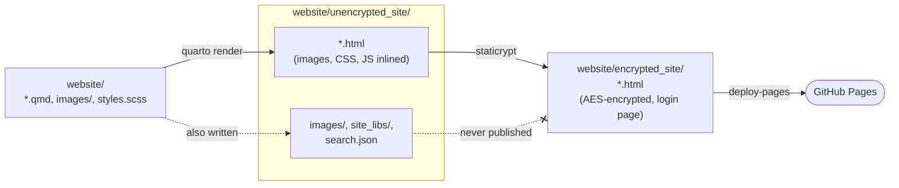

# "Private" static website through github pages

Let's say you are planning a party with 20 guests and need a way to communicate
details to them.  You could just create an email and send it out to everyone,
even use BCC to avoid reply-all avalanches!  But then whenever party details
change you'll need to send out another email.

Instead you could create a website for the event. That way you send a single
email with the URL and say "please check the website for updates".  Maybe you
already have a github account and are comfortable using github pages which is
free. That way you don't need a dedicated server, it's just a static website!

But you don't want this website to be completely public. Who knows what miscreants would
show up to the event! You also don't want the hassle of giving each guest their
own password. Instead you just want to share a single password for everyone like "BBQ".

So you definitely need a private github repo to hide your index.html, and maybe
you have a GitHub Pro account so that's not a problem. Unfortunately getting
a password-protected static website isn't trivial.

If you have a GitHub Enterprise account then you CAN have a private static
github pages which is gated through a GitHub login. But you're probably not
using GitHub Enterprise for this party planning, and not all of your
guests will have GitHub accounts anyway.

Fortunately, other people have thought of this problem and created tools like 
[StatiCrypt](https://github.com/robinmoisson/staticrypt) which makes it possible
to have a private static website anywhere, including github. The way it 
works is that the `index.html` IS public, but it's **encrypted**. So anyone can
visit and download your website, but without the shared-password it won't mean
anything to them.

The goal of this public repo is to show how to create a password-protected
static website written in [Quarto](https://quarto.org), encrypted with
[StatiCrypt](https://github.com/robinmoisson/staticrypt), and published to
GitHub Pages.

As long as you have the ability to make a private github repo then you
should be able to make your own private static website.

Go ahead and visit the website and use password "BBQ" to login:
https://biermanr.github.io/static_encrypted_website/

## Tools we'll be using

* Step 1: **[Quarto](https://quarto.org)**
  * Allows you to write markdown files and *render* them into HTML
  * Not required, you could make your index.html however you want!

* Step 2: **[StatiCrypt](https://github.com/robinmoisson/staticrypt)**
  * Encrypts your HTML files

* Github Actions CI
  * Runs the Quarto then StatiCrypt steps and publishes the github pages website
  * We'll set this up to run on each push to the main branch


## Workflow explanation

Inside of the `website/` folder of this repo you'll see files like `index.qmd`
and `menu.qmd` etc. These are the files we'll actually be editing as we make
the website.

Then when we're happy we can run `quarto preview website/` (you'll need to install quarto)
which should open a web browser to show you what the website will look like.
Besides opening your browser, the `quarto preview` command has also created
a new folder `website/unencrypted_site` which is where your HTML pages live.
It's not encrypted yet, we've only done the first step.

Then we need to run StatiCrypt (requires npx) to encrypt the HTML files produced by Quarto:

```bash
npx --yes staticrypt@3.5.4 website/unencrypted_site/*.html \
  --directory website/encrypted_site \
  --password BBQ \
  --short \
  --config false
```

Notice that we're setting the encryption password here!

Otherwise this command is taking as input the HTML files from the unencrypted folder
and outputting them to a new encrypted folder.

If you have python installed you can preview the encrypted website with a static server:
```bash
python3 -m http.server 8000 --bind 127.0.0.1 --directory website/encrypted_site
```

You should be forced to login using the password **BBQ**.

## Actual workflow

In the Workflow explanation above, we explicitly listed all the steps and commands,
but it's going to be the same every time so we have combined them into a single
script, [`build.sh`](build.sh):

```bash
sh build.sh             # render + encrypt into website/encrypted_site
sh build.sh --preview   # render + encrypt + serve it at http://localhost:8000
```

The GitHub Actions CI runs the same `sh build.sh` on every push to `main`, then
publishes `website/encrypted_site/` to GitHub Pages.

Here's a graphical representation of the steps:



## Setup

1. **Enable Pages.** Go to *Settings → Pages → Build and deployment →
   Source* and choose **GitHub Actions**.

2. Push to `main`. The site is published at
   `https://<user>.github.io/<repo>/`.

Publishing Pages from a **private** repo requires GitHub Pro, Team or
Enterprise. The source stays private, but the published site is public, which
is why it's encrypted.

## Caveats

- **The password is the only protection.** Anyone can download the encrypted
  pages and try passwords offline. Use a long passphrase for anything real
  (the demo uses `--short` to allow `BBQ`).
- **Page size.** Each page carries its own inlined copy of Bootstrap, the
  icon font and every image. That is about 1.6 MB of plaintext, or about
  1.9 MB per page over the wire after encryption. Resize photos before adding
  them.
- **Visible without the password:** the login page, the page file names, and
  the fact that the site exists.

## FAQ

- **Why do we need `embed-resources: true` in `_quarto.yml`?**

  StatiCrypt only encrypts HTML files, and the build only publishes HTML
  files. `embed-resources: true` puts each page's images, CSS, JavaScript and
  fonts inside the page itself, so they're encrypted with it. Without it,
  pages would point to image and stylesheet files that aren't published, so
  they'd show broken images and no styling.

- **Can I use Quarto's built-in search?**

  No. Quarto's search box works by downloading `search.json`, an index that
  contains the text of every page in plain text. The build only encrypts and
  publishes the HTML pages, so `search.json` is never published.

- **Do users need to enter the password for every page?**

  Only if they leave "Remember me" unticked. Every page is encrypted with the
  same password and salt, so after one login with "Remember me" ticked, the
  key is saved in the browser's `localStorage` with no expiry date, and every
  other page on the site opens automatically. To log out, add
  `#staticrypt_logout` to any page URL.

  StatiCrypt picks a new random salt on every build, so each deploy logs
  everyone out. To keep logins across deploys, pass a fixed `--salt` (any 32
  hex characters, e.g. from `openssl rand -hex 16`) in `build.sh`. The salt
  isn't secret, since it's embedded in every published page.

- **How do I use a real password instead of `BBQ`?**

  A password committed to the repo can be read by anyone with access to the
  repo, stays in the git history forever, and is exposed if the repo is ever
  made public. For a real site, use a GitHub secret instead:

  1. Remove `--password BBQ` from `build.sh`. StatiCrypt then reads
     the password from the `STATICRYPT_PASSWORD` environment variable.
  2. Add a repository secret: *Settings → Secrets and variables → Actions →
     New repository secret*, named `STATICRYPT_PASSWORD`.
  3. Pass it to the build step in `.github/workflows/publish.yml`:

     ```yaml
     - name: Build and encrypt
       env:
         STATICRYPT_PASSWORD: ${{ secrets.STATICRYPT_PASSWORD }}
       run: sh build.sh
     ```

## Contributing

Issues and pull requests are welcome, whether it's a bug fix, a clearer
explanation, or a question about how something works.
