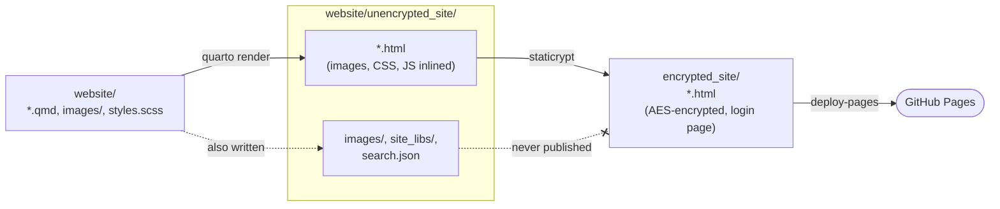

# static_encrypted_website

An example of a password-protected static website: a summer BBQ invitation
written in [Quarto](https://quarto.org), encrypted with
[StatiCrypt](https://github.com/robinmoisson/staticrypt), and published to
GitHub Pages from a private repo by GitHub Actions.

The demo password is **`BBQ`**. Because it's only an example, the password is
set in plain sight in [`scripts/build.sh`](scripts/build.sh). See the
[FAQ](#faq) for how to keep a real password secret.

## Layout

```
website/                     # the Quarto project: edit the site here
  _quarto.yml                #   site config (see FAQ for embed-resources, search)
  index.qmd, menu.qmd, ...   #   pages
  styles.scss, images/       #   theme and images (inlined at render time)
scripts/
  build.sh                   # render + encrypt (CI and local)
  preview.sh                 # build.sh, then serve on localhost
.github/workflows/publish.yml
```

Build output (gitignored): `website/unencrypted_site/` from Quarto and
`encrypted_site/`, the only folder that gets published.

## How it works



1. **`quarto render`** builds the site into `website/unencrypted_site/` with
   `embed-resources: true`, so every image, stylesheet, script and font is
   inlined into each page as a base64 `data:` URI.
2. **`staticrypt`** encrypts only the HTML pages into `encrypted_site/` and puts
   each one behind StatiCrypt's standard login page. Quarto also writes
   `images/`, `site_libs/` and `search.json` (a plaintext copy of every page)
   into `unencrypted_site/`. Those files are never copied to `encrypted_site/`.
3. **Deploy** `encrypted_site/` with `actions/deploy-pages`. Encrypted output is
   never committed to the repo.

StatiCrypt is given `*.html` from the top level only, so a page in a
subfolder would be left out of the site. It wouldn't be published
unencrypted.

All of this is in [`scripts/build.sh`](scripts/build.sh). CI and local
preview run the same script.

## Setup

1. **Enable Pages.** Go to *Settings → Pages → Build and deployment →
   Source* and choose **GitHub Actions**.

2. Push to `main`. The site is published at
   `https://<user>.github.io/<repo>/`.

Publishing Pages from a **private** repo requires GitHub Pro, Team or
Enterprise. The source stays private, but the published site is public, which
is why it's encrypted.

## Local preview

You need Quarto, Node.js and Python 3.

```bash
scripts/preview.sh        # builds, then serves http://localhost:8000
```

StatiCrypt needs WebCrypto, which only works over `https://` or on
`localhost`, so opening the HTML file directly won't work.

For editing without encryption, run `quarto preview website`.

## Caveats

- **The password is the only protection.** Anyone can download the encrypted
  pages and try passwords offline. Use a long passphrase for anything real
  (the demo uses `--short` to allow `BBQ`).
- **Page size.** Each page carries its own inlined copy of Bootstrap, the
  icon font and every image. That is about 1.6 MB of plaintext, or about
  1.9 MB per page over the wire after encryption. Resize photos before adding
  them.
- **Visible without the password:** the login page, the page file names, and
  the fact that the site exists.

## FAQ

- **Why do we need `embed-resources: true` in `_quarto.yml`?**

  StatiCrypt only encrypts HTML files, and the build only publishes HTML
  files. `embed-resources: true` puts each page's images, CSS, JavaScript and
  fonts inside the page itself, so they're encrypted with it. Without it,
  pages would point to image and stylesheet files that aren't published, so
  they'd show broken images and no styling.

- **Can I use Quarto's built-in search?**

  No. Quarto's search box works by downloading `search.json`, an index that
  contains the text of every page in plain text. The build only encrypts and
  publishes the HTML pages, so `search.json` is never published.

- **Do users need to enter the password for every page?**

  Only if they leave "Remember me" unticked. Every page is encrypted with the
  same password and salt, so after one login with "Remember me" ticked, the
  key is saved in the browser's `localStorage` with no expiry date, and every
  other page on the site opens automatically. To log out, add
  `#staticrypt_logout` to any page URL.

  StatiCrypt picks a new random salt on every build, so each deploy logs
  everyone out. To keep logins across deploys, pass a fixed `--salt` (any 32
  hex characters, e.g. from `openssl rand -hex 16`) in `build.sh`. The salt
  isn't secret, since it's embedded in every published page.

- **How do I use a real password instead of `BBQ`?**

  A password committed to the repo can be read by anyone with access to the
  repo, stays in the git history forever, and is exposed if the repo is ever
  made public. For a real site, use a GitHub secret instead:

  1. Remove `--password BBQ` from `scripts/build.sh`. StatiCrypt then reads
     the password from the `STATICRYPT_PASSWORD` environment variable.
  2. Add a repository secret: *Settings → Secrets and variables → Actions →
     New repository secret*, named `STATICRYPT_PASSWORD`.
  3. Pass it to the build step in `.github/workflows/publish.yml`:

     ```yaml
     - name: Build and encrypt
       env:
         STATICRYPT_PASSWORD: ${{ secrets.STATICRYPT_PASSWORD }}
       run: scripts/build.sh
     ```
